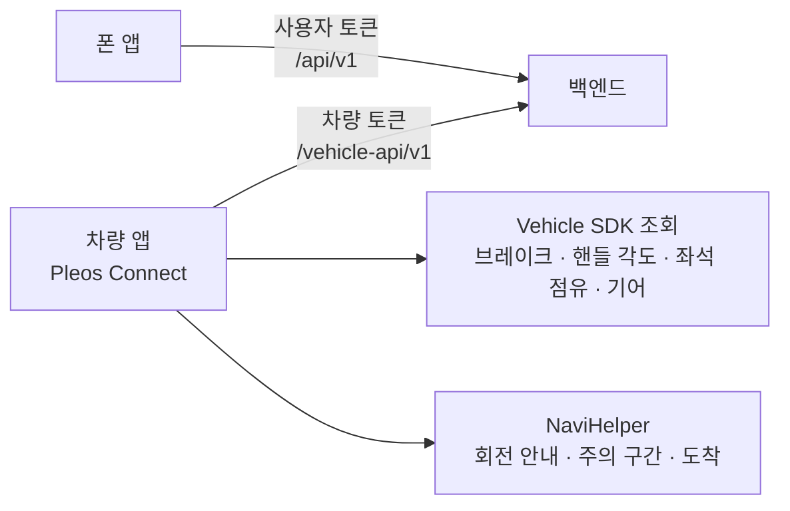
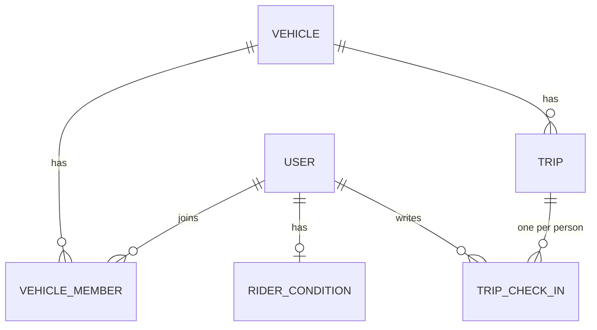
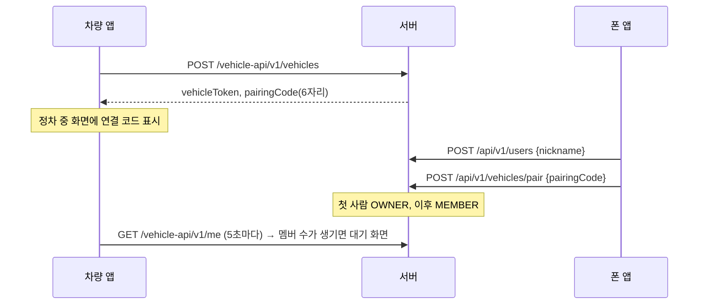
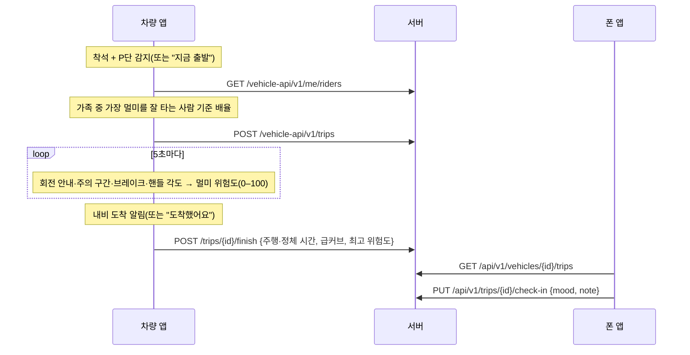

# 쉼표 백엔드 설계

쉼표는 함께 타는 사람의 몸(멀미)과 마음(정서)을 챙기는 차량 앱이다. 판단은 차량 앱이 차량 상태 조회 + 내비 정보로 하고, 서버는 그 결과와 사람이 남긴 기록을 보관한다.

예전 "가족 공유차 프로필" 설계는 `backup/family-profile` 브랜치에 있다.

## 1. 역할

| 클라이언트 | 경로 | 인증 | 하는 일 |
| --- | --- | --- | --- |
| 폰 앱 | `/api/v1/**` | 사용자 토큰 | 가입, 차량 연결·가족 관리, 내 컨디션, 트립 기록 보기, 도착 체크인 |
| 차량 앱 | `/vehicle-api/v1/**` | 차량 토큰 | 차량 등록, 가족 컨디션 받기, 트립 시작·종료(주행 요약) |

두 토큰은 서로의 API에 쓸 수 없다. 서버는 차량을 제어하지 않는다.

## 2. 데이터 모델

| 테이블 | 주요 컬럼 | 비고 |
| --- | --- | --- |
| `users` | nickname, token_hash | 비밀번호 없음. 토큰은 SHA-256 해시만 저장 |
| `vehicles` | model, token_hash, pairing_code(6자리), nickname | 차량 앱이 스스로 등록 |
| `vehicle_members` | vehicle_id, user_id, role(OWNER/MEMBER) | (vehicle, user) 유일 |
| `trips` | vehicle_id, started_at, ended_at, driving_minutes, congestion_minutes, sharp_turns, peak_risk | 차량당 열린 트립은 하나(새로 시작하면 이전 것을 닫음) |
| `trip_check_ins` | trip_id, user_id, mood, note(200) | (trip, user) 유일, 다시 남기면 덮어씀 |
| `rider_conditions` | user_id, motion_sensitivity, rest_style | 사람당 하나, 차와 무관 |

엔티티끼리는 JPA 연관관계 대신 UUID 컬럼으로만 참조한다. 지연 로딩·프록시 문제를 피하고, 조회는 서비스에서 묶는다.

## 3. 핵심 흐름

### 3-1. 처음 연결

### 3-2. 탑승 → 주행 중 케어 → 도착 체크인

## 4. 설계 결정

| # | 결정 | 이유 |
| --- | --- | --- |
| 1 | 멀미 위험도는 차량 앱에서 계산, 서버는 요약만 저장 | 신호가 차 안에서 나오고, 주행 중 네트워크가 끊겨도 동작해야 한다 |
| 2 | 위험도는 진단이 아니라 "미리 대비" 신호(0–100, 항목별 상한) | 의료 표현을 피한다. 한 가지 신호만으로 위험이 튀지 않게 한다 |
| 3 | 체크인은 기분 하나 + 한 줄, 서버는 해석하지 않음 | "상담"으로 오해되지 않게. 정서 케어는 본인 기록 중심 |
| 4 | 끝내지 못한 트립은 다음 시작 때 닫음, 종료는 재시도해도 같은 응답 | 앱 종료·통신 끊김에도 기록이 꼬이지 않게 |
| 5 | 남의 차·트립은 404 | 존재 여부를 노출하지 않는다 |
| 6 | 차량 제어(공조·조명·시트)·TTS는 쓰지 않음 | 팀 리서치 기준: 조회 + 내비만으로 완결. 제어가 확인되면 보너스로 얹는다 |
