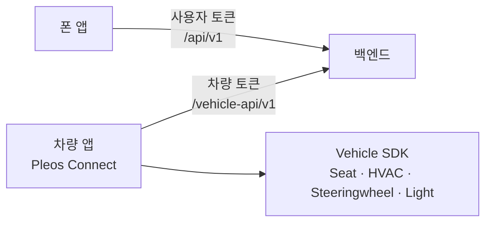
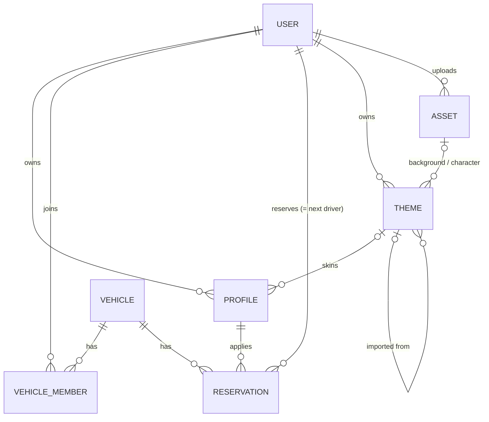
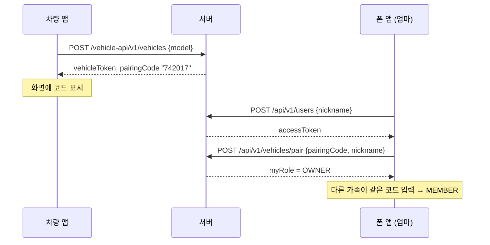
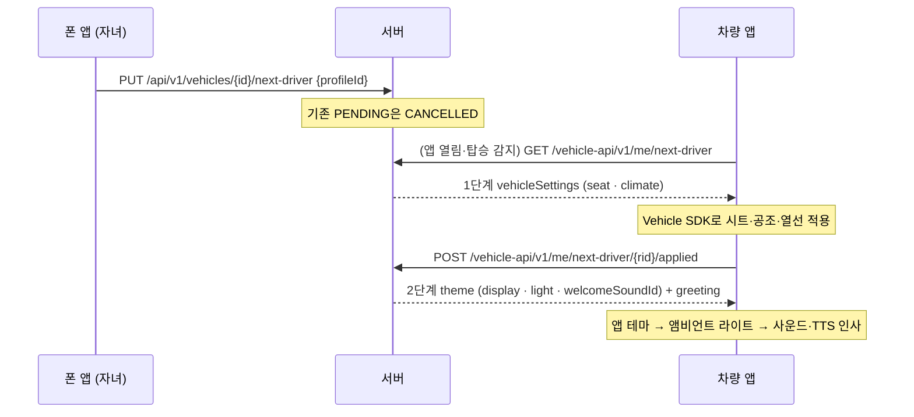
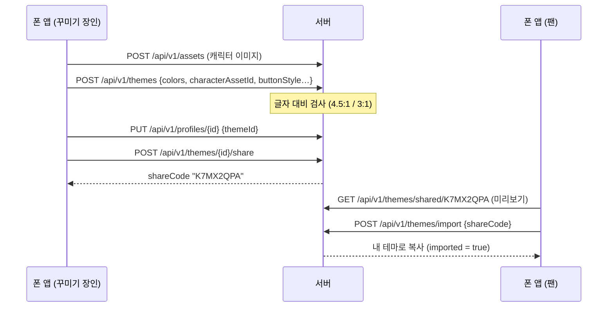

# 백엔드 설계

기준 문서: [Notion 공모전 페이지](https://app.notion.com/p/Pleos-4044c75bb8a781d4aa5ecb3bfcca8074) · 기획서 5장(시스템 구성)

## 1. 역할

차량 앱은 차 안에서만 돌기 때문에, 폰에서 만든 설정을 차로 넘기려면 서버가 중간에 있어야 한다.

| 클라이언트 | 경로 | 인증 | 하는 일 |
| --- | --- | --- | --- |
| 폰 앱 | `/api/v1/**` | 사용자 토큰 | 가입, 프로필·테마 편집, 테마 공유·마켓, 차량 페어링, 다음 운전자 예약 |
| 차량 앱 | `/vehicle-api/v1/**` | 차량 토큰 | 차량 등록, 탑승 시 예약 조회, 적용 완료 보고(→ 웰컴 묶음) |
| 공통 | `/files/{id}` | 없음 | 테마 이미지 내려받기 (추측 불가 UUID, 1년 캐시) |

두 토큰은 서로의 API에 쓸 수 없다.

## 2. 데이터 모델

| 테이블 | 주요 컬럼 | 비고 |
| --- | --- | --- |
| `users` | nickname, token_hash | 비밀번호 없음. 토큰은 SHA-256 해시만 저장 |
| `profiles` | owner_id, name, theme_id, widgets, seat·climate, light_brightness, welcome_sound | 사용자당 개수 무제한 |
| `themes` | owner_id, name, color_*, background/character_asset_id, button/widget/font_style, ambient_color, share_code, source_theme_id, import_count | 공유 코드는 공유 중일 때만 |
| `assets` | owner_id, content_type, size_bytes | 파일 본문은 `pleos.files.dir` 디스크에. 바뀌지 않음 |
| `vehicles` | model, token_hash, pairing_code(6자리), nickname | 차량 앱이 스스로 등록 |
| `vehicle_members` | vehicle_id, user_id, role(OWNER/MEMBER) | (vehicle, user) 유일 |
| `reservations` | vehicle_id, user_id, profile_id, status, applied_at | 차량당 PENDING 1개 |

엔티티끼리는 JPA 연관관계 대신 UUID 컬럼으로만 참조한다. 지연 로딩·프록시 문제를 피하고, 조회는 서비스에서 묶는다.

## 3. 핵심 흐름

### 3-1. 처음 연결

### 3-2. 다음 운전자 예약 → 탑승 시 2단계 적용

차량 설정(시트·공조·열선)을 먼저 적용하고, 그게 끝나야 웰컴 묶음(앱 테마·앰비언트 라이트·웰컴 사운드·인사말)을 받는다. 순서를 차량 앱 구현에 맡기지 않고 **API 응답을 나눠서 강제**한다.

- 시동 시 앱 자동 실행은 Pleos에서 지원되지 않는다(조사 보고서 참고). 트리거는 앱 열림, 탑승·도어 이벤트, 음성 버튼이다.
- 예약이 없으면 `GET next-driver`는 **204**. 차량 앱은 `GET /vehicle-api/v1/me/profiles`로 멤버별 프로필(차량 설정만)을 받아 1탭 선택 화면을 띄운다. 고른 프로필을 적용한 뒤 `POST /vehicle-api/v1/me/profiles/{profileId}/applied`로 같은 웰컴 묶음을 받는다.
- `applied`는 재시도해도 같은 웰컴 묶음을 돌려준다. 앱이 2단계 도중 꺼져도 다시 받을 수 있다. 취소된 예약이면 409.
- 예약된 프로필이 그 사이 삭제되면 예약이 없는 것으로 본다.

### 3-3. 테마: 만들기 → 프로필에 연결 → 공유

카카오톡 테마처럼 **차량 앱 화면 안**의 색·배경·캐릭터·버튼·위젯 모양을 바꾼다. 차량 런처·계기판은 OS 영역이라 대상이 아니다.

- **테마 = 공유할 수 있는 겉모습, 프로필 = 내 설정.** 위젯 목록·조명 밝기·사운드는 프로필, 색·이미지·모양·앰비언트 색은 테마.
- 차량 앱은 2단계 웰컴 묶음의 `skin`으로 화면을 다시 그린다. 폰 앱 미리보기·마켓도 같은 `skin` 모양을 쓰므로 렌더링 코드를 공유할 수 있다.
- **버튼·위젯 모양은 프리셋 규격**(`buttonStyle`, `widgetStyle`, `fontStyle`, `characterPlacement`)이다. 차량 앱은 처음부터 모든 컴포넌트를 이 값과 색 토큰으로 그려야 한다(Compose라면 `CompositionLocal`로 skin을 내려준다).
- 운전 중 안전: 대비 기준 미달 테마는 저장 거부, GIF(움직이는 이미지) 업로드 거부.
- 원작자 보호: 공유받은 테마는 복사본이며 다시 공유할 수 없다. 공유를 멈춰도 이미 받은 복사본은 남는다.
- 마켓은 공유 중인 테마를 `importCount` 순으로 보여준다. 라이선스 캐릭터 테마 판매는 사업화 장의 확장 포인트(MVP 범위 밖).

## 4. 설계 결정

| 결정 | 이유 | 나중에 바꿀 때 |
| --- | --- | --- |
| 비밀번호 없는 토큰 가입 | 데모·심사에서 가입 절차가 걸림돌이 되지 않게 | 소셜 로그인 추가, 기존 토큰 계정에 연결 |
| 불투명 토큰 + DB 해시 조회 (JWT 아님) | 단순함, 즉시 폐기 가능, 비밀키 관리 불필요 | 트래픽이 커지면 JWT/캐시 |
| Spring Security 미사용, 인터셉터로 인증 | 경로 2개·토큰 2종이면 충분 | 권한 체계가 복잡해지면 도입 |
| 남의 리소스는 403 대신 404 | 존재 여부를 노출하지 않음 | — |
| 페어링 코드 영구 고정 | 데모 단순화 | OWNER가 재발급, 유효시간 부여 |
| 차량 등록은 인증 없이 누구나 | 에뮬레이터 데모 우선 | Pleos 앱 서명·기기 인증 확인 후 제한 |
| H2 파일 DB, `ddl-auto: update` | 설치 없이 실행 | 운영은 PostgreSQL + Flyway 마이그레이션 |
| 이미지 `/files/{id}`는 토큰 없이 공개 | 차량·폰 이미지 로더가 헤더 없이 받고 캐시하도록. 주소는 추측 불가 UUID | 서명 URL(만료 시간) 또는 CDN |
| 이미지는 수정·삭제 없음 | 공유받은 테마가 같은 파일을 참조 | 참조 없는 파일 정리 배치 |

## 5. FE 연결 가이드

- Swagger UI: `http://localhost:8090/swagger-ui.html` (오른쪽 위에서 "폰 앱 / 차량 앱" 그룹 선택)
- OpenAPI 스펙: `/v3/api-docs/phone`, `/v3/api-docs/vehicle`. Retrofit 인터페이스를 손으로 쓰거나, openapi-generator로 생성할 수 있다.
- 에뮬레이터에서 호스트 PC는 `http://10.0.2.2:8090`. 실기기는 PC의 LAN IP를 쓰고 Windows 방화벽에서 8090을 열어야 한다.
- Android는 기본적으로 HTTP를 막는다. 개발 빌드에서만 `network_security_config`로 `10.0.2.2`의 cleartext를 허용한다.
- 모든 오류는 `application/problem+json`이고 `detail`에 한국어 설명이 들어 있다. 화면에는 `status`로 분기하고 `detail`을 보여주면 된다.
- 토큰 보관: 폰 앱은 `accessToken`, 차량 앱은 `vehicleToken`을 DataStore 등에 저장한다. 두 토큰 모두 발급 응답에서만 받을 수 있다.

## 6. 단계별 로드맵

| 단계 | 내용 | 상태 |
| --- | --- | --- |
| 1 | 프로필 CRUD | 완료 |
| 2 | 사용자·토큰 인증, 차량 등록·페어링, 다음 운전자 예약, 차량 앱 API, Swagger | 완료 |
| 3 | 2단계 적용(차량 설정 → 웰컴 묶음), 테마(색·배경·캐릭터·버튼/위젯 모양), 이미지 업로드, 공유 코드·마켓 | 완료 |
| 4 | 멤버 내보내기·나가기, 페어링 코드 재발급 | 예정 |
| 5 | 원격 사전 공조: 한국에 제3자 공개 API 없음(조사 결과) → "출발 예약 공조"(탑승 시 즉시 적용)로 대체 | 대체 |
| 6 | PostgreSQL + Flyway, 이미지 오브젝트 스토리지, 배포 (데모 영상 촬영 전) | 예정 |
| 7 | 시트 위치 모델 변경 (절대값 → 시트 메모리 슬롯 / 목표값+폐루프, 조사 보고서 참고) | 예정 |
