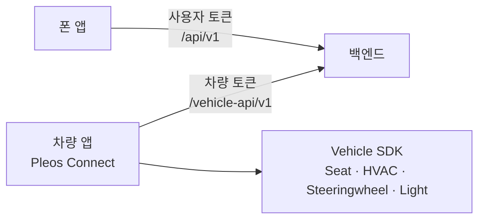
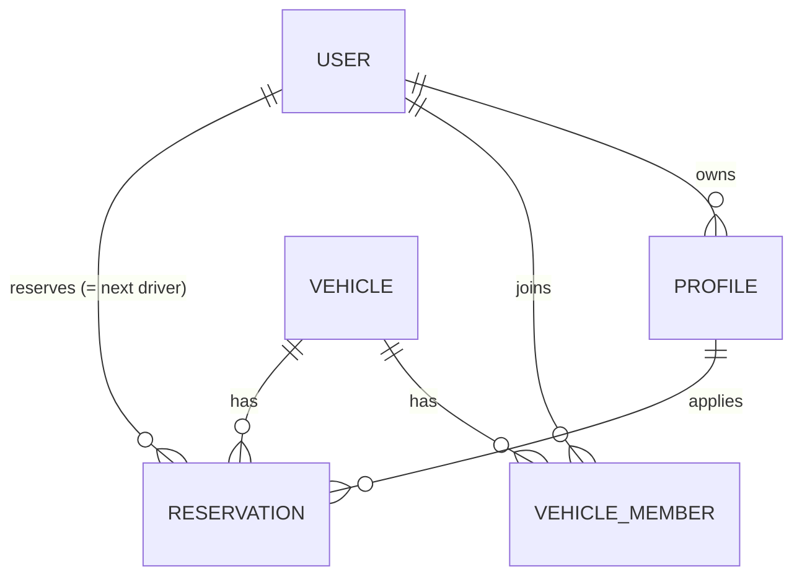
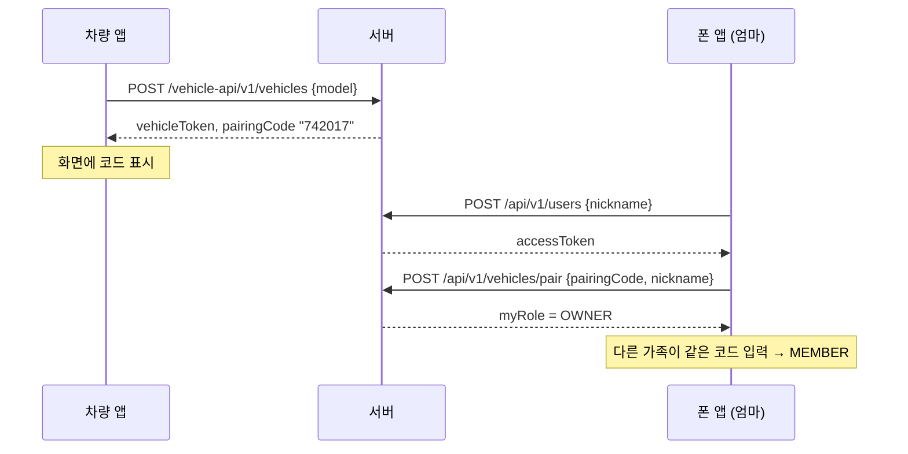
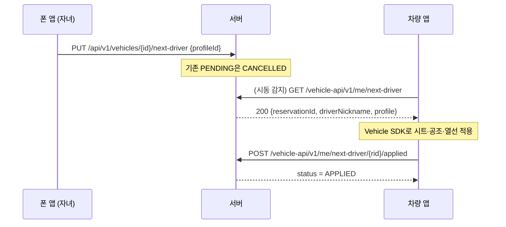

# 백엔드 설계

기준 문서: [Notion 공모전 페이지](https://app.notion.com/p/Pleos-4044c75bb8a781d4aa5ecb3bfcca8074) · 기획서 5장(시스템 구성)

## 1. 역할

차량 앱은 차 안에서만 돌기 때문에, 폰에서 만든 설정을 차로 넘기려면 서버가 중간에 있어야 한다.

| 클라이언트 | 경로 | 인증 | 하는 일 |
| --- | --- | --- | --- |
| 폰 앱 | `/api/v1/**` | 사용자 토큰 | 가입, 프로필 편집, 차량 페어링, 다음 운전자 예약 |
| 차량 앱 | `/vehicle-api/v1/**` | 차량 토큰 | 차량 등록, 시동 시 예약 조회, 적용 완료 보고 |

두 토큰은 서로의 API에 쓸 수 없다.

## 2. 데이터 모델

| 테이블 | 주요 컬럼 | 비고 |
| --- | --- | --- |
| `users` | nickname, token_hash | 비밀번호 없음. 토큰은 SHA-256 해시만 저장 |
| `profiles` | owner_id, name, display·seat·climate·light·welcome_sound | 사용자당 개수 무제한 |
| `vehicles` | model, token_hash, pairing_code(6자리), nickname | 차량 앱이 스스로 등록 |
| `vehicle_members` | vehicle_id, user_id, role(OWNER/MEMBER) | (vehicle, user) 유일 |
| `reservations` | vehicle_id, user_id, profile_id, status, applied_at | 차량당 PENDING 1개 |

엔티티끼리는 JPA 연관관계 대신 UUID 컬럼으로만 참조한다. 지연 로딩·프록시 문제를 피하고, 조회는 서비스에서 묶는다.

## 3. 핵심 흐름

### 3-1. 처음 연결

### 3-2. 다음 운전자 예약 → 시동 시 적용

- 예약이 없으면 `GET next-driver`는 **204**. 이때 차량 앱은 `GET /vehicle-api/v1/me/profiles`로 멤버별 프로필을 받아 **1탭 선택 화면**을 띄운다. 기획서에 적힌, 시동 시 자동 실행이 막힐 때의 대체안이다.
- `applied`는 재시도해도 안전하다. 같은 요청을 다시 보내도 200이고, 취소된 예약이면 409다.
- 예약된 프로필이 그 사이 삭제되면 예약이 없는 것으로 본다.

## 4. 설계 결정

| 결정 | 이유 | 나중에 바꿀 때 |
| --- | --- | --- |
| 비밀번호 없는 토큰 가입 | 데모·심사에서 가입 절차가 걸림돌이 되지 않게 | 소셜 로그인 추가, 기존 토큰 계정에 연결 |
| 불투명 토큰 + DB 해시 조회 (JWT 아님) | 단순함, 즉시 폐기 가능, 비밀키 관리 불필요 | 트래픽이 커지면 JWT/캐시 |
| Spring Security 미사용, 인터셉터로 인증 | 경로 2개·토큰 2종이면 충분 | 권한 체계가 복잡해지면 도입 |
| 남의 리소스는 403 대신 404 | 존재 여부를 노출하지 않음 | — |
| 페어링 코드 영구 고정 | 데모 단순화 | OWNER가 재발급, 유효시간 부여 |
| 차량 등록은 인증 없이 누구나 | 에뮬레이터 데모 우선 | Pleos 앱 서명·기기 인증 확인 후 제한 |
| H2 파일 DB, `ddl-auto: update` | 설치 없이 실행 | 운영은 PostgreSQL + Flyway 마이그레이션 |

## 5. FE 연결 가이드

- Swagger UI: `http://localhost:8090/swagger-ui.html` (오른쪽 위에서 "폰 앱 / 차량 앱" 그룹 선택)
- OpenAPI 스펙: `/v3/api-docs/phone`, `/v3/api-docs/vehicle`. Retrofit 인터페이스를 손으로 쓰거나, openapi-generator로 생성할 수 있다.
- 에뮬레이터에서 호스트 PC는 `http://10.0.2.2:8090`. 실기기는 PC의 LAN IP를 쓰고 Windows 방화벽에서 8090을 열어야 한다.
- Android는 기본적으로 HTTP를 막는다. 개발 빌드에서만 `network_security_config`로 `10.0.2.2`의 cleartext를 허용한다.
- 모든 오류는 `application/problem+json`이고 `detail`에 한국어 설명이 들어 있다. 화면에는 `status`로 분기하고 `detail`을 보여주면 된다.
- 토큰 보관: 폰 앱은 `accessToken`, 차량 앱은 `vehicleToken`을 DataStore 등에 저장한다. 두 토큰 모두 발급 응답에서만 받을 수 있다.

## 6. 단계별 로드맵

| 단계 | 내용 | 상태 |
| --- | --- | --- |
| 1 | 프로필 CRUD | 완료 |
| 2 | 사용자·토큰 인증, 차량 등록·페어링, 다음 운전자 예약, 차량 앱 API, Swagger | 완료 |
| 3 | 테마 공유 링크 (프로필 → 공유 코드 → 복사), 기획서의 MVP 대체안 | 예정 |
| 4 | 멤버 내보내기·나가기, 페어링 코드 재발급 | 예정 |
| 5 | 사전 공조 연동 검토 (블루링크 공개 API 여부 확인 후) | 보류 |
| 6 | PostgreSQL + Flyway, 배포 (데모 영상 촬영 전) | 예정 |
